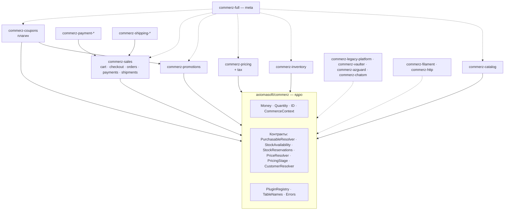

# Архитектура: пакеты, ядро-контракты, точки расширения

## 0. Позиция в одном абзаце

Модульный монолит в одной транзакционной PostgreSQL. **Ядро `axiomasoft/commerz`** — единственная точка
взаимодействия модулей (как `src/` в legacy-platform): value objects, контракты между модулями, реестр плагинов, именование
таблиц. Шесть доменных пакетов зависят **только от ядра**, никогда друг от друга. Акции — отдельный пакет со своим
SPI, купоны — плагин к нему. Платежи, доставка, налоги, медиа, поиск — порты с адаптерами. Никаких микросервисов,
никакого event sourcing, никакой подмены моделей.

## 1. Цели v1 и сознательные «нет»

| v1 делает | v1 не делает (и почему) |
|---|---|
| Несколько магазинов и каналов продаж в одной установке | Marketplace-расчёты с продавцами (split payouts) — другой денежный домен |
| Несколько складов, резервы, журнал движений, перемещения (v1.1) | Адресное хранение (ячейки), партии, серийные номера, себестоимость (FIFO) — WMS/ERP; заложена точка роста (database.md §5.6) |
| Товары/варианты/опции/атрибуты/типы товаров, категории | Конфигураторы «собери сам» с ценообразованием по формуле — через `ProductKind`-плагин позже |
| Прайс-листы, ступенчатые цены, группы покупателей, налоги по ставкам | Налоговые движки юрисдикций (Avalara и пр.) — адаптер к порту `TaxCalculator` |
| Акции (каталожные и корзинные), купоны-плагин, лимиты и бюджеты | Подарочные сертификаты — это **платёжное средство и обязательство**, не скидка; отдельный пакет позже |
| Корзина, оформление, заказ-снимок, платежи и отгрузки как записи | Подписки/рекуррентные платежи |
| Порты: платёж, доставка, налог, медиа, поиск, клиент | HTTP API и админка в ядре — отдельные пакеты `commerz-http`, `commerz-filament` |

## 2. Пакеты



| Пакет | Владеет | Зависит от | Ставится отдельно? |
|---|---|---|---|
| `axiomasoft/commerz` | `cmz_stores`, `cmz_channels`, `cmz_schema_state`, `cmz_outbox_messages`; VO, контракты, реестр | `illuminate/*`, `brick/math` | да (без него ничего) |
| `commerz-catalog` | товары, варианты, опции, атрибуты, типы, категории, публикации | ядро | да: каталог без продаж (витрина/PIM) |
| `commerz-inventory` | номенклатура, места хранения, уровни, движения, резервы, перемещения | ядро | **да: складской учёт без каталога** |
| `commerz-pricing` | прайс-листы, цены, налоговые классы/ставки, базовые стадии конвейера | ядро | да |
| `commerz-promotions` | акции, условия, эффекты, лимиты, движок | ядро | да (вместе с sales, но не обязан) |
| `commerz-coupons` | коды, генерация партий, погашения | ядро, promotions | плагин |
| `commerz-sales` | корзины, заказы, строки-снимки, корректировки, платежи, отгрузки, возвраты (v1.1) | ядро | да; без catalog работает с хостовыми «покупаемыми» через `PurchasableResolver` |

**Почему 6, а не 1 и не 12.** Существующий синтез оставил выбор A/B/C открытым
([design-hypotheses.md](../../docs/discovery/2026-10-08/design-hypotheses.md) §2); ChatGPT предложил 12 пакетов включая
`support`, `stores`, `search`, `integrations`, `commerce`-композицию
([architecture-appendix.md](../chatgpt/architecture-appendix.md) §2). Наш критерий — **есть ли реальный сценарий
установки без соседа**: склад без каталога (1С/ERP-синхронизация, склад для чужого магазина), каталог без продаж
(PIM/витрина), акции как самостоятельная требуемая владельцем граница. `stores` — не пакет: магазин и канал нужны всем
модулям, это ядро. `support` — тоже ядро. `search` и `integrations` — порты + адаптеры, а не домены. Отдельный
пакет-«композиция» не нужен: связки, которым нужен владелец (вариант ↔ номенклатура), живут в модуле, которому они
нужны для инварианта (inventory, см. database.md §5.2).

Если владелец решит, что все проекты ставят полный набор, — тот же код живёт в одном Composer-артефакте с теми же
модулями, а границы держит архитектурный тест. Переход 1→6 дешёвый, только если границы соблюдены с первого дня.

## 3. Ядро — что в нём и почему

### 3.1. Value objects (`final readonly`, без Laravel)

| Тип | Суть | Решение |
|---|---|---|
| `Money` | `int $amountMinor` + `Currency` | целые минорные единицы, как `money` в `legacy-platform-custom-fields` (`{minor, currency}`); промежуточная арифметика (проценты, распределение) — `brick/math` с явным `RoundingMode` |
| `Currency` | ISO 4217 + `exponent` | встроенный справочник, порт `CurrencyMetadata` (мост к `legacy-platform-intl`) |
| `Quantity` | `int` в базовой единице номенклатуры | 1,5 кг = 1500 г; без decimal в счётчиках склада (database.md §5.1) |
| `ProductId`, `VariantId`, `OrderId`, … | обёртки над UUIDv7-строкой | разные типы → нельзя перепутать в сигнатуре |
| `PurchasableRef` | `type` + `id` | то, что кладут в корзину: вариант каталога, услуга хоста, подарочный сертификат |
| `CustomerRef`, `ActorRef` | `type:id` хоста | как `ActorRef` Chatom; без FK на users |
| `CommerceContext` | `StoreId`, `ChannelId`, `Currency`, `locale`, `?CustomerRef`, `customerGroups`, `at: DateTimeImmutable` | неизменяемый, передаётся явно в каждую операцию; **не** singleton |

### 3.2. Контракты между модулями (ядро объявляет, модуль реализует)

| Контракт (ядро) | Реализует | Использует | Без реализации |
|---|---|---|---|
| `PurchasableResolver::resolve(PurchasableRef, CommerceContext): PurchasableSnapshot` | catalog (или хост) | sales, pricing, promotions | ошибка конфигурации при загрузке |
| `StockAvailability::available(PurchasableRef, ChannelId): AvailabilityAnswer` | inventory | catalog (витрина), sales | явный выбор `commerz.availability = unlimited`; молча «всё в наличии» нельзя |
| `StockReservations::reserve(ReserveStock): ReservationResult` / `release` / `consume` | inventory | sales | то же |
| `PriceResolver::unitPrice(PurchasableRef, int $quantity, CommerceContext): ResolvedPrice` | pricing | sales, catalog | ошибка |
| `PricingStage` (SPI, конвейер расчёта) | pricing, promotions, sales(shipping), tax | `PricingPipeline` ядра | стадия просто не зарегистрирована |
| `CustomerResolver` | хост (или мост к legacy-platform/AzGuard) | promotions, pricing | гость |
| `ProductMediaStore`, `CatalogIndexer` | мосты / адаптеры | catalog | без медиа / SQL-поиск |

Это ровно принцип legacy-platform «пакеты общаются через контракты ядра, пакет заменим»: inventory можно заменить внешним
складом (адаптер к 1С/МойСклад), реализовав два контракта, и sales этого не заметит.

### 3.3. Реестр плагинов

Закрытый набор **видов вкладов** (по образцу закрытых 8 extenders legacy-platform, `legacy-platform/docs/dev-doctrine.md:72`):

| Вид вклада | Ключ | Кто объявляет SPI |
|---|---|---|
| `AttributeType` | `text`, `decimal`, `acme.color_swatch` | catalog |
| `ProductKind` | `physical`, `digital`, `service`, `bundle` | catalog |
| `PromotionCondition` | `cart.subtotal_at_least`, `customer.in_group` | promotions |
| `PromotionEffect` | `line.percent_off`, `order.fixed_off`, `buy_x_get_y` | promotions |
| `PromotionActivator` | `automatic`, `coupon` | promotions |
| `PricingStage` | `base`, `promotions.cart`, `tax`, … на якоре | ядро |
| `AllocationStrategy` | `channel_priority`, `nearest`, `single_location` | inventory |
| `PaymentGateway` | `yookassa`, `stripe` | sales |
| `ShippingRateProvider` | `flat`, `cdek` | sales |
| `TaxCalculator` | `rates`, `avalara` | pricing |

Плагин — класс `CommerzPlugin` с `manifest()` (id, версия, зависимости) и `register(PluginRegistrar)`, как
`Chatom\Plugins\Contracts\Plugin` (`chatom/packages/core/src/Plugins/Contracts/Plugin.php:11–21`). При загрузке
реестр компилируется и **замораживается**: дубль ключа, неизвестная зависимость, цикл — ошибка загрузки.
В БД хранится **стабильный ключ** вклада, не FQCN. Подробно — [flexibility-and-config.md](flexibility-and-config.md).

## 4. Модули — ответственность и главные инварианты

| Модуль | Feature modules | Инвариант, который охраняет только он |
|---|---|---|
| catalog | `Products`, `Variants`, `Options`, `Attributes`, `ProductTypes`, `Categories`, `Listings` | комбинация осей уникальна внутри товара; значение атрибута проходит тип и правила; вариант принадлежит товару |
| inventory | `Locations`, `StockItems`, `Levels`, `Movements`, `Reservations`, `Transfers` | `reserved ≥ 0`, `on_hand ≥ 0` (если не разрешён минус), `on_hand − reserved ≥ 0` при резерве; каждое изменение `on_hand` = строка журнала |
| pricing | `PriceLists`, `Prices`, `Tax`, `Pipeline` | у цены одна валюта, нет пересечения интервалов одной цены; выбор цены детерминирован |
| promotions | `Promotions`, `Conditions`, `Effects`, `Engine`, `Usage` | сумма распределённых скидок = итоговой скидке; лимит/бюджет не превышается конкурентно |
| coupons | `Coupons`, `Batches`, `Redemptions` | код уникален после нормализации; лимит кода и на покупателя |
| sales | `Carts`, `Checkout`, `Orders`, `Payments`, `Shipments`, `Returns` | заказ — неизменяемый снимок; повтор размещения не создаёт второй заказ; отгружено ≤ заказано |

## 5. Конвейер расчёта (pricing pipeline)

Одна функция расчёта для корзины, оформления и пересчёта заказа-черновика:

```text
PricingInput(lines, context, codes) ─► [base] ─► [catalog_promotions] ─► [cart_promotions] ─► [shipping]
   ─► [shipping_promotions] ─► [tax] ─► [totals] ─► PricingResult(lines, adjustments, totals, explanations)
```

- Якоря **фиксированы и упорядочены** (enum `PricingAnchor`). Плагин вставляет стадию `before`/`after` якоря, а не в
  произвольное место. Это ответ на «прерывания везде» Magento и «рой hooks», запрещённый legacy-platform (`dev-doctrine.md:78`).
- Стадия — чистая функция `(PricingState): PricingState`; `PricingState` неизменяем (`with*()`), каждая корректировка
  несёт `source` (ключ стадии/акции) и объяснение. Ни одна стадия не пишет в БД.
- Налог после скидок — дефолт для РФ/ЕС; цены «с НДС» (tax-inclusive) — флаг канала, `tax`-стадия выделяет налог из суммы.
- Результат детерминирован: одинаковый вход → одинаковый выход (тест-снапшоты).

## 6. Магазины, каналы, склады, арендаторы

| Понятие | Что это | Таблица | Связи |
|---|---|---|---|
| Store | бизнес-единица: продавец, юр. реквизиты, нумерация заказов, валюта по умолчанию | `cmz_stores` | 1..N каналов |
| Channel | точка продаж: сайт, POS, маркетплейс, B2B-портал | `cmz_channels` | принадлежит store; локали/валюты; прайс-листы; склады с приоритетом (`cmz_stock_location_channels`); публикации товаров |
| Stock location | физический склад / магазин / ПВЗ / «в пути» | `cmz_stock_locations` | M:N к каналам |
| Tenant | граница изоляции данных | **нет колонки** | отдельное соединение/БД |

**Арендаторы: без `tenant_id` в схеме.** Существующие материалы закладывают `scope_id` логически в каждую таблицу
([logical-schema-candidate.md](../../docs/discovery/2026-10-08/logical-schema-candidate.md) §1). Мы против: legacy-platform уже выбрал
**DB-per-account** (ADR-004, `legacy-platform/docs/dev-doctrine.md:175`), а shared-table tenancy требует tenant в каждом unique,
FK, кэше, очереди, поиске — сами же материалы это признают (design-hypotheses §4). Commerz работает на соединении,
которое ему дали (`commerz.connection` или резолвер хоста); изоляция — забота хоста/legacy-platform. Несколько магазинов внутри
одной БД — штатно, через `store_id`/`channel_id`. Если владельцу нужен SaaS на общих таблицах — это отдельное
решение до первой миграции (Нужно обсудить, risks §1).

## 7. Оформление заказа — граница транзакции

```text
HTTP/команда PlaceOrder(cartId, idempotencyKey)
 └─ вне транзакции: пересчёт PricingResult, валидация адресов/доставки, выбор плана размещения (AllocationStrategy)
 └─ BEGIN
      1. INSERT cmz_orders … ON CONFLICT (cart_id) → вернуть существующий заказ (идемпотентность)
      2. резерв склада: уровни в порядке stock_level_id, условный UPDATE (prototype E2)
      3. лимиты: coupon FOR UPDATE → promotion условный UPDATE (prototype E5–E7)
      4. строки-снимки, корректировки, адреса, outbox(OrderPlaced)
    COMMIT
 └─ после коммита: создание платежа через PaymentGateway (сеть — никогда внутри транзакции)
```

- Резерв при размещении заказа (`ReservationTiming::OnOrderPlaced`) — дефолт. `OnCheckoutStart` (с TTL) — опция
  для дефицитных товаров. `OnAddToCart` — не предлагаем: корзины-«зомби» держат остаток.
- Неоплаченный заказ держит резерв до `payment_due_at`; затем отмена → release резерва и возврат лимитов акций.
- Списание `on_hand` — при отгрузке (`shipment shipped` → movement `sale`, резерв `consumed`), не при оплате.
  Оплата и физика — разные события (согласны с design-hypotheses §10).

## 8. Состояния — три независимых enum

`OrderState`: `draft → placed → completed | cancelled`.
`PaymentState` (агрегат по платежам): `unpaid → authorized → partially_paid → paid → partially_refunded → refunded`.
`FulfillmentState` (агрегат по отгрузкам): `unfulfilled → partially_fulfilled → fulfilled → partially_returned → returned`.
Переходы — метод enum `canTransitionTo()` + таблица `cmz_order_events` (журнал). Универсальный state-machine пакет
не нужен (legacy-platform-workflow — для процессов, не для трёх enum).

## 9. События и интеграция

Доменные события — `final readonly` классы в `Events/` модуля, публикуются **после коммита**; для внешних
потребителей — запись в outbox в той же транзакции (`cmz_outbox_messages` или `sys_outbox_messages` через мост legacy-platform).
Подписки — только в коде (legacy-platform: «подписки ТОЛЬКО в коде манифеста», `dev-doctrine.md:70`).
Ключевые: `ProductPublished`, `VariantCreated`, `StockLevelChanged`, `StockReserved`, `OrderPlaced`, `OrderCancelled`,
`PaymentCaptured`, `ShipmentShipped`, `PromotionUsageExhausted`.

## 10. Встраивание в хост

- Публичный API — контракты и команды (`final readonly` DTO в `Data/`), без фасадов как основного пути
  (фасад `Commerz` — тонкая обёртка для удобства).
- HTTP-контроллеры, Filament — отдельные пакеты; ядро не знает о транспорте (как Chatom «Keep the PHP core transport-agnostic», `chatom/AGENTS.md`).
- Хост поставляет: соединение, `CustomerResolver`, авторизацию (`Gate`/AzGuard-мост), медиа-хранилище, очередь.
- Мосты: `commerz-legacy-platform` (модуль, схема, tenancy, outbox, custom-fields для доп. полей заказа/покупателя),
  `commerz-azguard` (права `commerz.orders.refund` …), `commerz-vaulter` (медиа товаров), `commerz-chatom`
  (чат по заказу как подписчик `OrderPlaced`). Ядро ни от одного не зависит.
