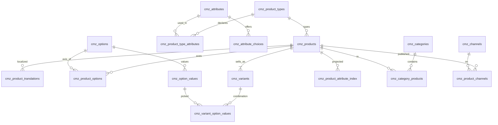
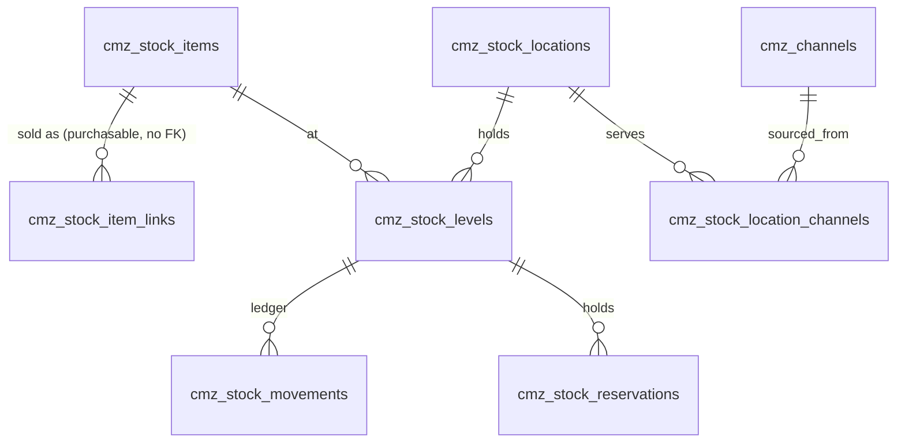
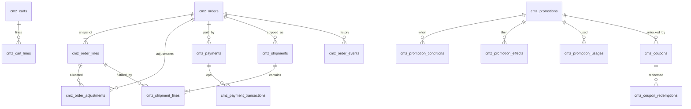

# База данных: идеальная схема Commerz (PostgreSQL)

Ключевые инварианты проверены на живом PostgreSQL 17 — [prototype/results.md](prototype/results.md).
Префиксы и имена ограничений — [ecosystem-alignment.md](ecosystem-alignment.md) §5.

## 1. Общие правила схемы

| Правило | Решение | Почему |
|---|---|---|
| СУБД | только PostgreSQL ≥ 16 | `EXCLUDE`, `NULLS NOT DISTINCT`, `jsonb`, частичные индексы, `ltree`; legacy-platform уже PG-first |
| PK | `uuid` (v7, генерирует приложение) | экосистема (legacy-platform ADR-003, Chatom); слияние БД, импорт, ID до INSERT |
| Журналы | `bigint GENERATED ALWAYS AS IDENTITY` | `cmz_stock_movements`, `cmz_order_events`, `cmz_outbox_messages` — порядок и компактность |
| Деньги | `<name>_minor bigint` + одна `currency char(3)` на строку-владельца | точно, быстро, совпадает с `money` в `legacy-platform-custom-fields`; строки заказа наследуют валюту заказа |
| Количество на складе | `bigint` в базовой единице номенклатуры (шт., г, мл, мм) | целочисленный условный UPDATE, без ошибок округления; дробность — выбор базовой единицы |
| Количество в строке продажи | `integer` продаваемых единиц | 1 строка = N штук варианта; «0,35 кг» = вариант с базовой единицей г и шагом (risks §4) |
| Ставки | `rate_bp integer` (базисные пункты: 2000 = 20 %) | без decimal в налогах; 0,01 % точности достаточно для РФ/ЕС/США |
| Enum | `varchar(32)` + `CHECK (col IN (…))`, источник — PHP backed enum | нативный PG `enum` трудно эволюционировать; так делает legacy-platform (`*_status_ck`) |
| Время | `timestamptz`; интервалы действия — `tstzrange` | `EXCLUDE … WITH &&` для непересечения |
| Мягкое удаление | **нет** `deleted_at` | ломает уникальные ключи и исторические ссылки; вместо — `status = archived` |
| Переводы | короткие подписи — `jsonb {"ru": "...", "en": "..."}`; длинный индексируемый текст (name, slug, description товара) — таблица `*_translations` | slug уникален в локали → нужна строка, а не JSON |
| Расширение хостом | `meta jsonb` на products, variants, stock_items, orders | неиндексируемые заметки интегратора; типизированные поля — атрибуты/custom-fields |
| FK | только внутри пакета **и вниз по Composer-зависимости** (к ядру; coupons → promotions) | legacy-platform DATA-004 (`constitution.md:263`); inventory не знает `cmz_variants` |
| Хостовые ссылки | `*_ref varchar(128)` вида `user:42` | без FK на таблицы хоста (как Vaulter/AzGuard) |

## 2. Полный список таблиц

Жирным — v1. Курсивом — v1.1. Остальное — точка роста.

### 2.1. Ядро `axiomasoft/commerz`

| Таблица | Ключевые колонки | Ограничения / индексы |
|---|---|---|
| **cmz_stores** | id, code, name, default_currency, default_locale, order_number_format, status | `_code_uq` |
| **cmz_channels** | id, store_id, code, name, currencies `char(3)[]`, locales `varchar(16)[]`, is_tax_inclusive, status | `_code_uq`; FK store; `CHECK (cardinality(currencies) > 0)` |
| **cmz_schema_state** | package, table_prefix, schema_version, fingerprint, installed_at | PK(package) — prefix заморожен после установки |
| **cmz_outbox_messages** | id bigint, event_type, event_version, aggregate_type, aggregate_id, payload jsonb, occurred_at, published_at, attempts | `_unpublished_ix (id) WHERE published_at IS NULL` |

### 2.2. Каталог `commerz-catalog`

| Таблица | Ключевые колонки | Ограничения / индексы |
|---|---|---|
| **cmz_product_types** | id, code, name jsonb, kind (`ProductKind` key), has_variants | `_code_uq` |
| **cmz_product_type_attributes** | product_type_id, attribute_id, level (`product`/`variant`), is_required, position | PK(type, attribute) |
| **cmz_product_type_options** | product_type_id, option_id, position | PK — какие оси допустимы типу |
| **cmz_products** | id, product_type_id, handle, status, owner_store_id NULL, attributes jsonb, meta jsonb, published_at | `_handle_uq`; `_attributes_gin (attributes jsonb_path_ops)`; `CHECK jsonb_typeof(attributes)='object'` |
| **cmz_product_translations** | product_id, locale, name, slug, description, seo jsonb | PK(product, locale); `_locale_slug_uq` |
| **cmz_options** | id, code, name jsonb, display (`select`/`swatch`/`button`), position | `_code_uq` |
| **cmz_option_values** | id, option_id, code, label jsonb, swatch, position | `_option_id_code_uq`; `_id_option_id_uq` (для составного FK) |
| **cmz_product_options** | product_id, option_id, position | PK(product, option) |
| cmz_product_option_values | product_id, option_id, option_value_id | разрешённое подмножество значений (идея `available_codes` Unbox) |
| **cmz_variants** | id, product_id, sku, barcode, option_signature, status, position, attributes jsonb, weight_g, length_mm, width_mm, height_mm, requires_shipping, tax_class_code, meta | `_sku_uq`; `_barcode_uq WHERE barcode IS NOT NULL`; `_product_id_option_signature_uq`; `_id_product_id_uq` |
| **cmz_variant_option_values** | variant_id, product_id, option_id, option_value_id | PK(variant, option); 3 составных FK (prototype E1) |
| **cmz_attributes** | id, code, type (`AttributeType` key), name jsonb, unit, is_localizable, is_filterable, config jsonb, config_version, status | `_code_uq`; `status IN (active, deprecated, retired)` |
| **cmz_attribute_choices** | id, attribute_id, code, label jsonb, position | `_attribute_id_code_uq` (для `select`/`multiselect`) |
| **cmz_product_attribute_index** | product_id, variant_id NULL, attribute_id, choice_id, num numeric, flag bool, day date, term varchar(255) | `(attribute_id, choice_id, product_id)`, `(attribute_id, num)`; проекция, пишется синхронно (§4) |
| **cmz_categories** | id, parent_id, code, path `ltree`, name jsonb, slug jsonb, position | `_code_uq`; `_path_gist_ix` (как `sys_departments_path_gist_ix` legacy-platform) |
| **cmz_category_products** | category_id, product_id, position | PK |
| **cmz_product_channels** | product_id, channel_id, is_visible, visible_from, visible_until | PK; FK channel → ядро |
| **cmz_product_media** | id, product_id, variant_id, option_value_id, media_ref, role, position | картинки по цвету — через `option_value_id` (идея `ProductColor` Unbox) |
| cmz_product_relations | product_id, related_product_id, kind (`upsell`/`cross_sell`/`accessory`), position | PK(product, related, kind) |

### 2.3. Склад `commerz-inventory`

| Таблица | Ключевые колонки | Ограничения / индексы |
|---|---|---|
| **cmz_stock_locations** | id, code, name, kind (`warehouse`/`store`/`pickup_point`/`virtual`), address jsonb, timezone, status | `_code_uq` |
| **cmz_stock_location_channels** | location_id, channel_id, priority | PK; откуда продаёт канал и в каком порядке |
| **cmz_stock_items** | id, sku, name, base_unit, is_tracked, allows_backorder, meta | `_sku_uq` |
| **cmz_stock_item_links** | purchasable_type, purchasable_id, stock_item_id, quantity | PK(type, id, item); `quantity > 0` — набор/упаковка = несколько строк/коэффициент |
| **cmz_stock_levels** | id, stock_item_id, location_id, on_hand, reserved, safety_stock, allows_negative, version, updated_at | `_stock_item_id_location_id_uq`; `CHECK reserved >= 0`; `CHECK allows_negative OR on_hand >= 0`; `CHECK safety_stock >= 0` |
| **cmz_stock_movements** | id bigint, stock_level_id, stock_item_id, location_id, kind, delta, balance_after, source_type, source_id, reason, actor_ref, occurred_at, recorded_at | `_source_uq (source_type, source_id, stock_level_id, kind)`; `(stock_level_id, id)`; BRIN(recorded_at); `delta <> 0` |
| **cmz_stock_reservations** | id, stock_level_id, demand_type, demand_id, line_ref, quantity, consumed, state, expires_at | `_demand_uq (demand_type, demand_id, line_ref, stock_level_id)`; `consumed <= quantity`; `_expiry_ix (stock_level_id, expires_at) WHERE state='active'` |
| *cmz_stock_transfers* | id, number, from_location_id, to_location_id, state, shipped_at, received_at | |
| *cmz_stock_transfer_lines* | transfer_id, stock_item_id, quantity, received | `received <= quantity` |
| *cmz_stock_counts* / *cmz_stock_count_lines* | инвентаризация: ожидаемое, посчитанное, корректировка | |
| cmz_stock_lots / cmz_stock_serials | партии/серийники **рядом** с уровнем, не в ключе (§5.6) | |

### 2.4. Цены и налоги `commerz-pricing`

| Таблица | Ключевые колонки | Ограничения / индексы |
|---|---|---|
| **cmz_price_lists** | id, code, kind (`base`/`sale`/`contract`), currency, store_id, channel_id, customer_group, priority, starts_at, ends_at, status | `_code_uq`; `UNIQUE NULLS NOT DISTINCT (currency, store_id, channel_id, customer_group, priority)` — нет «двух одинаково приоритетных» |
| **cmz_prices** | id, price_list_id, purchasable_type, purchasable_id, min_quantity, amount_minor, compare_at_minor, valid_during | `EXCLUDE USING gist (price_list_id =, purchasable_type =, purchasable_id =, min_quantity =, valid_during &&)` (prototype E1); `amount_minor >= 0` |
| **cmz_tax_classes** | id, code, name jsonb | `_code_uq` |
| **cmz_tax_zones** | id, code, countries `char(2)[]`, regions `varchar(16)[]` | `_code_uq` |
| **cmz_tax_rates** | id, tax_class_id, tax_zone_id, rate_bp, valid_during | `EXCLUDE (class =, zone =, valid_during &&)`; `rate_bp BETWEEN 0 AND 10000` |

### 2.5. Акции `commerz-promotions` и купоны `commerz-coupons`

Подробно — [promotions-and-coupons.md](promotions-and-coupons.md).

| Таблица | Ключевые колонки | Ограничения / индексы |
|---|---|---|
| **cmz_promotions** | id, code, name jsonb, label jsonb, status, activation, stage, priority, stacking, match, starts_at, ends_at, usage_limit, usage_count, per_customer_limit, budget_minor, budget_currency, spent_minor, revision | `_code_uq`; `usage_count <= usage_limit`; `spent_minor <= budget_minor`; `_active_ix (stage, priority) WHERE status='active'` |
| **cmz_promotion_conditions** | id, promotion_id, type, config jsonb, config_version, position | `(promotion_id, position)` |
| **cmz_promotion_effects** | id, promotion_id, type, config jsonb, config_version, position | `(promotion_id, position)` |
| **cmz_promotion_customer_usages** | promotion_id, customer_ref, usage_count | PK; условный upsert `WHERE usage_count < limit` |
| **cmz_promotion_usages** | id, promotion_id, promotion_revision, order_id, customer_ref, discount_minor, currency, state | `_promotion_id_order_id_uq`; журнал для возврата лимита при отмене |
| **cmz_coupons** | id, promotion_id, batch_id, code, customer_ref, usage_limit, usage_count, per_customer_limit, starts_at, ends_at, status | `_code_uq`; `code ~ '^[A-Z0-9]{3,64}$'` (нормализованный); FK promotion (вниз по зависимости) |
| **cmz_coupon_batches** | id, promotion_id, prefix, length, alphabet, quantity, generated | |
| **cmz_coupon_redemptions** | id, coupon_id, order_id, customer_ref, state | `_coupon_id_order_id_uq`; `(coupon_id, customer_ref) WHERE state='redeemed'` |

### 2.6. Продажи `commerz-sales`

| Таблица | Ключевые колонки | Ограничения / индексы |
|---|---|---|
| **cmz_carts** | id, store_id, channel_id, currency, locale, customer_ref, token, codes `varchar(64)[]`, status, version, expires_at, meta | `_token_uq`; `(customer_ref) WHERE status='active'` |
| **cmz_cart_lines** | id, cart_id, purchasable_type, purchasable_id, quantity, customization jsonb, customization_hash, position | `_merge_uq (cart_id, purchasable_type, purchasable_id, customization_hash)`; `quantity > 0` |
| **cmz_orders** | id, number, store_id, channel_id, cart_id, customer_ref, email, currency, locale, state, payment_state, fulfillment_state, subtotal_minor, discount_minor, shipping_minor, tax_minor, total_minor, paid_minor, refunded_minor, is_tax_inclusive, billing_address jsonb, shipping_address jsonb, pricing_context jsonb, placed_at, payment_due_at, cancelled_at, completed_at, version, meta | `_store_id_number_uq`; `_cart_id_uq` (идемпотентность размещения); `_totals_ck` (см. §6) |
| **cmz_order_lines** | id, order_id, purchasable_type, purchasable_id, product_kind, sku, name, options jsonb, attributes jsonb, quantity, unit_price_minor, subtotal_minor, discount_minor, tax_minor, total_minor, tax_class_code, tax_rate_bp, stock_links jsonb, fulfilled_quantity, cancelled_quantity, returned_quantity, position | `quantity > 0`; `fulfilled + cancelled <= quantity`; `returned <= fulfilled`; `total = subtotal - discount (+tax)` |
| **cmz_order_adjustments** | id, order_id, order_line_id, target (`line`/`shipping`), kind (`promotion`/`tax`/`manual`), source_type, source_id, source_revision, code, label jsonb, amount_minor, is_included, application_id | `(order_id)`; сумма по `application_id` = итог применения (PRM-02) |
| **cmz_order_events** | id bigint, order_id, type, from_state, to_state, actor_ref, payload jsonb, occurred_at | `(order_id, id)` |
| **cmz_order_number_sequences** | store_id, period, last_value | PK(store, period); `UPDATE … RETURNING` в транзакции размещения |
| **cmz_payments** | id, order_id, gateway, method, amount_minor, currency, state, external_id, idempotency_key | `_idempotency_key_uq`; `_gateway_external_id_uq` |
| **cmz_payment_transactions** | id, payment_id, kind, amount_minor, status, external_id, payload jsonb, occurred_at | `_payment_id_kind_external_id_uq` — повтор webhook не удваивает (INV-01) |
| **cmz_shipments** | id, order_id, location_id, method_code, carrier_ref, tracking_number, state, shipping_minor, shipped_at, delivered_at | |
| **cmz_shipment_lines** | shipment_id, order_line_id, quantity | PK; `quantity > 0` |
| *cmz_returns* / *cmz_return_lines* | запрос, приёмка, disposition (`restock`/`quarantine`/`scrap`) | возврат товара ≠ возврат денег |
| *cmz_refunds* / *cmz_refund_lines* | payment_id, amount_minor, по строкам и исходным корректировкам | refund не делает `on_hand += q` (REF-01) |

Итого v1 ≈ 50 таблиц. Это не «на будущее»: каждая отвечает на конкретный инвариант или запрос из §5–7.

## 3. ER-диаграммы







## 4. Хранение свойств: сравнение и выбор

Подробная модель — [product-properties.md](product-properties.md). Здесь — решение по хранению.

| Вариант | Запись | Фильтр/фасет | Целостность | Эволюция | Вердикт |
|---|---|---|---|---|---|
| Колонки | ⚡ | ⚡ | FK/CHECK | миграция на каждое поле | **для универсальных полей**: sku, barcode, вес, габариты, налоговый класс |
| Опции (реляционно) | средне | ⚡ (prototype E8) | составные FK | справочник | **для осей вариантов** — всегда |
| Typed EAV (Magento/Bagisto/ChatGPT atoms) | N строк на сущность, дорого на импорт | хорошо при правильных индексах | FK на choice | тип меняется по строкам | ✗ — сложность ChatGPT-варианта (values/groups/atoms × 2 владельца) не окупается |
| JSONB-документ (Lunar, `legacy-platform-custom-fields`) | 1 строка | GIN `@>` для равенства; диапазоны и фасеты слабее | в коде (тип-реестр) | документная миграция | **для описательных атрибутов** |
| JSONB + синхронная typed-проекция | 1 строка + K строк индекса в той же транзакции | ⚡ фасеты, диапазоны, sameVariant | проекция пересобираема | rebuild команда | **выбор** для `is_filterable` атрибутов |

**Почему синхронная проекция, а не асинхронная.** Существующий вариант G
([attribute-storage-options.md](../../docs/discovery/2026-10-08/attribute-storage-options.md) §9) отвергается из-за лага и
«двух операционных процедур». Синхронная запись тем же обработчиком в той же транзакции снимает лаг и вопрос
версий: проекция всегда соответствует документу, а `commerz:catalog:reindex` нужен только после смены типа/правил.
Внешний поиск (Meilisearch/OpenSearch через `CatalogIndexer`) — отдельная асинхронная проекция для полнотекста.

## 5. Склад: счётчики + журнал + адресные резервы

### 5.1. Модель

```text
available(level) = on_hand − reserved − safety_stock
available(item, channel) = Σ available(level) по локациям канала (cmz_stock_location_channels)
```

- `cmz_stock_levels` — **текущее состояние** (счётчики), меняется только условным `UPDATE` в транзакции.
- `cmz_stock_movements` — **неизменяемый журнал** каждого изменения `on_hand` с `balance_after`; исправление —
  компенсирующее движение. `Σ delta = on_hand` проверяется командой сверки.
- `cmz_stock_reservations` — **обязательства**; `reserved = Σ (quantity − consumed)` активных броней, проверяется сверкой.
- Резерв — **адресный** (на уровень = товар × локация), план размещения выбирает `AllocationStrategy` до транзакции,
  финальная проверка — в `UPDATE … WHERE on_hand − reserved − safety_stock >= :q`.

### 5.2. Почему так, а не иначе

| Альтернатива | Кто так делает | Почему не берём |
|---|---|---|
| Только журнал броней без счётчика (salable = Σ sources − Σ reservations) | Magento MSI `inventory_reservation` (`docs/discovery/2026-10-08/external/sources/magento/inventory/InventoryReservations/etc/db_schema.xml`) | каждая проверка — агрегат; для «последней единицы» всё равно нужна блокировка; MSI сам признаёт гонки на горячих SKU |
| Счётчик `reserved` read-then-write в приложении | Medusa `packages/modules/inventory/src/services/inventory-module.ts:262–303` (читает уровни, проверяет, пишет `reserved = прочитанное + q`; строка не блокируется — сериализация остаётся на вызывающем workflow) | теряет обновления без внешней блокировки — prototype E3: счётчик 20, броней 640 при остатке 50 |
| `quantity_allocated` + броней с `reserved_until`, истечение фильтром | Saleor `saleor/warehouse/models.py:527–538, 668–691` | хорошая идея ленивого истечения — **берём**, но в виде освобождения внутри транзакции резерва (prototype E4), а не `SUM` на каждом чтении |
| Пул доступности + поздняя allocation (I-B) | design-hypotheses §8 | двойное обещание при пересекающихся пулах; сами авторы пишут «I-B не считается законченной схемой». Канальная доступность у нас — **вычисление** Σ по локациям канала, а не отдельный счётчик |
| `stock_resources` + `dimension_key` + allocations + transitions | logical-schema-candidate §5 | 5 таблиц и протокол переносов ради WMS-измерений, которых нет в v1; рост — §5.6 |
| `float stocklevel` | Aimeos `setup/default/schema/stock.php:39` | float для количества недопустим |

### 5.3. Резерв (конкурентно корректный)

```sql
-- внутри транзакции размещения; уровни отсортированы по id, чтобы исключить дедлоки
WITH expired AS (            -- ленивое истечение (prototype E4)
  UPDATE cmz_stock_reservations SET state = 'expired'
   WHERE stock_level_id = :level AND state = 'active' AND expires_at < now()
  RETURNING quantity - consumed AS q)
UPDATE cmz_stock_levels
   SET reserved = reserved - (SELECT coalesce(sum(q),0) FROM expired) + :qty, version = version + 1
 WHERE id = :level
   AND (allows_negative OR on_hand - (reserved - (SELECT coalesce(sum(q),0) FROM expired)) - safety_stock >= :qty);
-- 0 строк → InsufficientStock; иначе INSERT cmz_stock_reservations … ON CONFLICT (demand) DO NOTHING
```

Идемпотентность — естественный ключ брони `(demand_type, demand_id, line_ref, stock_level_id)`, отдельная таблица
`command_receipts` (logical-schema §9) не нужна. Повтор с тем же спросом — no-op.

### 5.4. Жизненный цикл

| Событие | `on_hand` | `reserved` | Журнал | Бронь |
|---|---|---|---|---|
| Приёмка | +q | — | `receipt` | — |
| Размещение заказа | — | +q | — | `active` |
| Отгрузка (частичная) | −q | −q | `sale` | `consumed += q` |
| Отмена / истечение | — | −(quantity−consumed) | — | `released`/`expired` |
| Возврат принят как годный | +q | — | `return` | — |
| Возврат в брак | — | — | (не приходуется или `return` в локацию `quarantine`) | — |
| Инвентаризация | ±diff | — | `count` | брони сохраняются; если `on_hand < reserved` — событие `StockShortage` |
| Перемещение | −q / +q | — | `transfer_out` / `transfer_in` | «в пути» = отгружено − принято по строкам перемещения |

### 5.5. Наборы и упаковки

`cmz_stock_item_links`: вариант «упаковка 12 шт.» → item `bottle` × 12; набор «подарочный» → 3 строки.
Резерв набора — по строке на компонент в одной транзакции; ёмкость набора = `min(floor(available_i / qty_i))`
(формула совпадает с ChatGPT §8.5). Заказ сохраняет использованные связи в `cmz_order_lines.stock_links`, изменение
рецептуры завтра не трогает вчерашний заказ.

### 5.6. Рост к WMS без переделки ключа

Партии/серийники/ячейки **не входят** в ключ уровня. Они добавляются таблицами-детализацией
(`cmz_stock_lots(level_id, lot_code, expires_on, on_hand)`, `cmz_stock_serials(level_id, serial, state)`) с
инвариантом `Σ lots.on_hand = level.on_hand` для уровней с `tracking = lot`. Уровень остаётся точкой блокировки и
резерва; партия выбирается при отгрузке (FEFO-стратегия). Это и есть ответ на замечание design-hypotheses §8
«нельзя пообещать добавим потом плагином без способа эволюции ключа» — ключ не эволюционирует.

## 6. Деньги

- `Money(amountMinor: int, currency: Currency)`; суммирование только одинаковых валют (иначе исключение).
- Проценты и распределение — `brick/math` `BigDecimal` с явным `RoundingMode` (по умолчанию `HALF_UP` для налога,
  `DOWN` для скидки — скидка не должна превышать заявленную); итог сохраняется как `int`.
- **Распределение скидки по строкам — метод наибольшего остатка**: сумма аллокаций == скидке (PRM-02), остаток копеек
  — строкам с наибольшей дробной частью, при равенстве — по порядку строк (детерминизм).
- `cmz_orders_totals_ck`: `total_minor = subtotal_minor - discount_minor + shipping_minor + CASE WHEN is_tax_inclusive THEN 0 ELSE tax_minor END`.
- Валюта заказа одна; мультивалютный каталог — разными прайс-листами, не конвертацией на лету (курс — забота
  прайс-листа/импорта; мост `legacy-platform-intl` может генерировать прайс-лист по курсу).

## 7. Снимок заказа

Строка заказа самодостаточна: по ней можно напечатать документ через 5 лет при удалённом каталоге.

| Что | Где | Почему |
|---|---|---|
| sku, name (локаль заказа), опции `[{option, value, label}]`, ключевые атрибуты | `cmz_order_lines` | каталог меняется/удаляется |
| unit_price, subtotal, discount, tax, total, tax_rate_bp, tax_class | `cmz_order_lines` | пересчёт по живым ценам запрещён (ORD-02) |
| каждая скидка/налог с `source_type/source_id/source_revision`, код купона, подпись | `cmz_order_adjustments` | частичный возврат должен вернуть «свою» долю скидки |
| версии прайс-листов и акций, контекст (канал, группа покупателя, время расчёта) | `cmz_orders.pricing_context` | объяснимость и аудит |
| использованные связи склада | `cmz_order_lines.stock_links` | рецептура набора на момент продажи |
| адреса | `cmz_orders.*_address` jsonb | адресная книга покупателя — хост |

`purchasable_id` хранится без FK. Изменение заказа после размещения — только командами с событием в `cmz_order_events`
(отмена строки, частичный возврат), никогда UPDATE «на месте» сумм без следа.

## 8. Горячие запросы и индексы

| Запрос | Индекс |
|---|---|
| Витрина: товары канала с фасетами | `cmz_product_channels (channel_id, product_id) WHERE is_visible`; `cmz_product_attribute_index (attribute_id, choice_id, product_id)`, `(attribute_id, num)` |
| Вариант по комбинации | `cmz_variants_product_id_option_signature_uq` |
| Цена в контексте | `cmz_prices (purchasable_type, purchasable_id, price_list_id)` + gist exclusion |
| Доступность варианта в канале | `cmz_stock_item_links` PK → `cmz_stock_levels_stock_item_id_location_id_uq` |
| Просроченные брони (sweeper) | `cmz_stock_reservations_expiry_ix` частичный |
| Активные акции стадии | `cmz_promotions_active_ix` частичный |
| Купон по коду | `cmz_coupons_code_uq` |
| Заказы покупателя | `cmz_orders (customer_ref, placed_at DESC)` |
| Неопубликованный outbox | частичный по `published_at IS NULL` |

Партиционирование `cmz_stock_movements`/`cmz_order_events` по месяцу — когда журнал > 50 млн строк; ключ
`(id)` + `recorded_at` уже это позволяет. В v1 не нужно.
