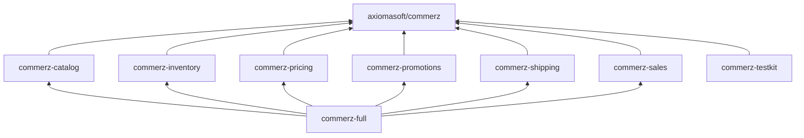

# Commerz architecture

Commerz is a **headless, transport-agnostic commerce engine for Laravel**: the
domain core of trade (stores and channels, catalog, stock, prices and taxes,
promotions and coupons, delivery, cart → order → payment → fulfillment →
return) shipped as a family of Composer packages. It is the same class of
product as Chatom is for chat: the host application builds its product on top
of Commerz and owns its own data.

These documents are the binding architecture. Plans and research are
temporary; when they disagree with this directory, this directory wins until a
new decision is recorded in [decisions.md](decisions.md).

## Positioning

The main criterion for every decision is embeddability: an online store and a
CRM must both install Commerz without carrying code they do not use.

| Consumer | Installs | Host provides |
|---|---|---|
| Online store | `axiomasoft/commerz-full` | storefront, authentication, payment adapter |
| CRM (Flex CRM and others) | core + `commerz-sales` (+ pricing/promotions) | its own sellable entities via `SellableProvider`, customers via `CustomerDirectory` |
| Stock / accounting sync | core + `commerz-inventory` | item source, import |
| PIM / catalog showcase | core + `commerz-catalog` (+ pricing) | UI, media |
| POS / B2B portal | `commerz-full` or a subset | transport, permissions |

Commerz deliberately is **not**: a storefront or admin panel (future
`commerz-http`, `commerz-filament`), a payment provider or carrier (SPI and
adapters only), a WMS/ERP (bins, lots, serials, cost price), a marketplace
settlement engine, a jurisdiction tax engine (port only), a subscription
engine, or gift cards/loyalty (future packages).

Flexibility principle: **data is as flexible as possible, configuration is
minimal and typed, behavior changes only through a closed set of SPIs.** No
Eloquent model swapping, no generic before/after hooks, no subscriptions stored
in the database, no executable code in configuration.

## Package map

Feature packages depend only on the core and talk to each other through core
ports (`Commerz\Ports\*`) and events. Details: [packages.md](packages.md).

## Documents

| Document | Contents |
|---|---|
| [packages.md](packages.md) | packages, table ownership, dependency rules, code layout, future packages |
| [api.md](api.md) | public API conventions and abbreviated per-package examples |
| [extension.md](extension.md) | the five extension mechanisms, plugins, contribution kinds, quote pipeline |
| [data.md](data.md) | table prefix, keys, money, quantities, snapshots, tenancy and context |
| [invariants.md](invariants.md) | invariant registry, order placement transaction, global lock order |
| [decisions.md](decisions.md) | accepted architecture decisions D1–D15 with rationale |

Research corpus behind these choices: `docs/discovery/2026-10-08/`, `audits/`.

## Stack

PHP >=8.4 <8.7 (CI on 8.4, 8.5 and 8.6), Laravel ^13 (`illuminate/*` ^13), PostgreSQL ≥ 16 (CI on 16 and 19), Pest
with Orchestra Testbench, PHPStan max with strict rules and Larastan, Pint,
Rector. The local default `php` may be older; run PHP and Composer through
`scripts/php84`.

## Quality gates

- Tests live in `packages/<pkg>/tests/{Unit,Feature}`; feature tests run on
  real PostgreSQL (`postgres:19` in Docker). SQLite never proves locking.
- Architecture gates in `tests/Arch`: dependency direction, no foreign
  `Internal` imports, `#[Api]`/`#[Spi]` markers on public types, migrations
  touch only the package's own table nouns, no Eloquent types in public
  signatures, negative fixtures against vacuous passes.
- Concurrency tests are mandatory for stock, promotion limits, order placement
  and payment webhooks: N parallel processes on PostgreSQL via
  `Commerz\Testkit\Concurrency`.
- The testkit ships in-memory fakes of every port and `PluginContractTests`.
